<div align="center">


[](https://github.com/agentstack201?tab=followers)
[](https://github.com/agentstack201?tab=repositories)


<br/><br/>




<details>
<summary><sub>VIEW AS TEXT</sub></summary>

```python
class AhmadHisham:
    """Arabic roots, modern stack."""

    def __init__(self):
        self.name      = {"en": "Ahmad Hisham", "ar": "أحمد هشام"}
        self.username  = "@agentstack201"
        self.role      = "Full-Stack Developer & AI Systems Architect"
        self.languages = {
            "Arabic":  "Native — لغة الضاد",
            "English": "Professional",
        }
        self.passion   = {
            "en": "Turning ideas into systems, and systems into products",
            "ar": "تحويل الأفكار إلى أنظمة ذكية تخدم الإنسان",
        }
        self.skills = {
            "ai_agents":  ["Multi-Agent Systems", "LLM Orchestration", "Claude", "Gemini"],
            "full_stack": ["Next.js", "React", "Node.js", "TypeScript", "Python"],
            "cloud_data": ["PostgreSQL", "Prisma", "Supabase", "Docker", "Vercel"],
        }

    def say_welcome(self, guest: str = "friend") -> str:
        # In Arab hospitality, coffee comes before conversation.
        coffee = "قهوة عربية بالهيل"  # Arabic coffee with cardamom
        return "\n".join([
            f"{coffee} — أهلاً وسهلاً",
            f"Welcome, {guest}! Coffee's on me — let's build something meaningful.",
        ])


print(AhmadHisham().say_welcome())
```

</details>

<br/>




<br/><br/>








<br/><br/>


<a href="https://github.com/agentstack201/HISN"></a>
<a href="https://github.com/agentstack201/Nabd-Hospital"></a>
<a href="https://github.com/agentstack201/Quran-Karim-"></a>
<a href="https://github.com/agentstack201/raseed"></a>

<br/><br/>


<br/><br/>


<br/><br/>


<picture>
  <source media="(prefers-color-scheme: dark)" srcset="https://raw.githubusercontent.com/agentstack201/agentstack201/output/snake-dark.svg" />
  <source media="(prefers-color-scheme: light)" srcset="https://raw.githubusercontent.com/agentstack201/agentstack201/output/snake-light.svg" />
  
</picture>

<br/><br/>



</div>
