 

I'm **Ahmad Hisham**, a full-stack developer working on AI agent systems and Arabic-first web products. I care about software that is correct, fast, and genuinely useful to the people who rely on it.

مطوّر برمجيات، أعمل على أنظمة الوكلاء الذكية ومنتجات ويب تبدأ بالعربية. أحبّ العمل المتقَن الذي ينفع الناس فعلًا.

### Now

- Building [**HISN**](https://github.com/agentstack201/HISN), a security assessment platform for websites you own.
- Exploring multi-agent workflows: planning, tool use, and agents that check their own work.
- Open to collaborating on AI agents, full-stack products, and Arabic-first software.

### Selected work

- [**HISN**](https://github.com/agentstack201/HISN) · حِصن — Non-intrusive security checks for TLS, headers, cookies and common misconfigurations, with the evidence behind every finding. `Next.js` `TypeScript` `Supabase`
- [**Nabd Hospital**](https://github.com/agentstack201/Nabd-Hospital) · نبض — Hospital platform with an Arabic RTL site, booking that blocks double-booking at the database level, a patient portal and an admin dashboard. `Next.js` `Prisma` `PostgreSQL`
- [**Tilawa**](https://github.com/agentstack201/Quran-Karim-) · تلاوة — Offline-first Quran PWA: the full Mus'haf in Uthmani script, diacritic-insensitive search, tafsir and recitation audio. `TypeScript` `PWA`
- [**Raseed**](https://github.com/agentstack201/raseed) · رصيد — Arabic personal budgeting and savings app. Your data never leaves your browser. `TypeScript`

### Stack

- **Languages:** TypeScript, JavaScript, Python, C++
- **Web:** Next.js, React, Vite, Tailwind CSS, Node.js, Express
- **Data:** PostgreSQL, Prisma, Supabase, Neon
- **AI:** Claude, Gemini, OpenRouter, DeepSeek — multi-agent systems, LLM orchestration
- **Shipping:** Docker, Vercel, Render, GitHub Actions, Vitest, Playwright

---

« خيرُ النّاسِ أنفعُهم للنّاس »

<i>The best of people are those most beneficial to others.</i>

